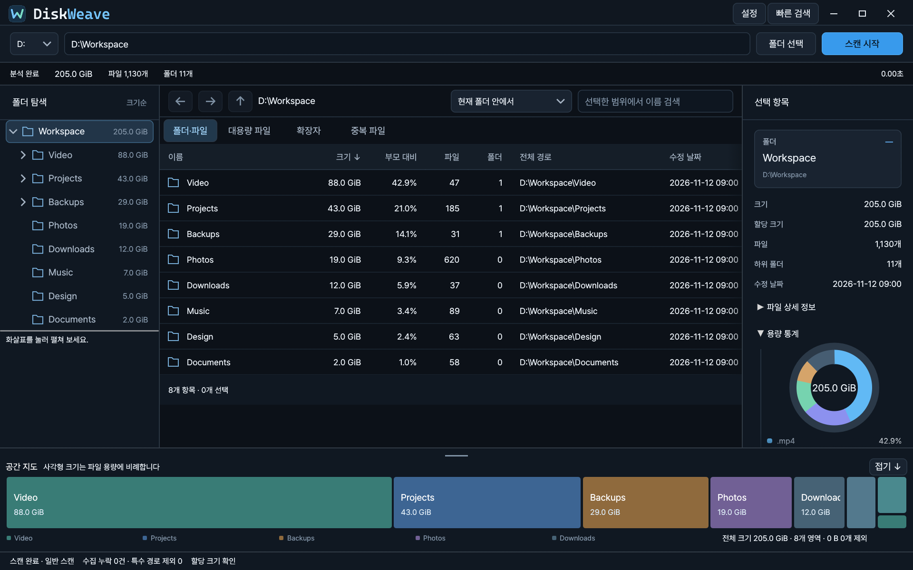

<h1 align="center">
  
</h1>

<strong>Windows용 디스크 분석 및 파일 검색</strong>

  폴더 트리와 공간 지도로 어디서 용량을 쓰는지 살펴보고, 찾은 파일은 같은 화면에서 열거나 정리할 수 있습니다.

  <a href="https://github.com/ghminx/DiskWeave/releases/download/v0.1.5/DiskWeave-0.1.5-windows-x64-preview.zip"><strong>Download for Windows</strong></a>
  · <a href="#getting-started">Getting Started</a>
  · <a href="docs/portable-readme.md">User Guide</a>
  · <a href="https://github.com/ghminx/DiskWeave/releases/tag/v0.1.5">Release Notes</a>

Windows 10/11 x64 · 설치 없이 실행하는 Portable ZIP

*예시 데이터로 구성한 이전 버전의 용량 분석 화면*

## Getting Started

1. 위에서 ZIP을 내려받고 압축을 푼 다음 `DiskWeave.exe`를 실행하세요.
2. 드라이브나 폴더를 고르고 **스캔 시작**을 누르면 폴더별 용량과 파일 수가 나옵니다.
3. 파일을 찾으려면 목록 위 검색칸에 이름이나 경로를 입력하세요. 아직 스캔하지 않은 곳은 **다른 폴더 지정** 또는 **내 PC 전체**를 고른 뒤 검색을 시작하면 됩니다. 결과는 같은 목록에 나옵니다.

다른 앱을 쓰는 중에도 검색이 필요하다면 우측 상단 **설정**에서 전역 단축키를 켜세요. 기본 조합은 `Ctrl+Alt+Space`이며, 누르면 작은 검색창이 열립니다.

## What You Can Do

- **용량을 많이 쓰는 폴더 찾기** — 공간 지도에서 큰 폴더를 살펴보고, 대용량 파일 목록이나 확장자별 통계에서 어떤 파일이 공간을 차지하는지 확인합니다.
- **여러 폴더의 파일 정리하기** — 폴더를 나란히 열거나 탭으로 오가면서 파일을 복사하고 옮길 수 있습니다. 파일을 휴지통으로 보내기 전에는 확인 창이 뜹니다.
- **중복 파일 찾기** — 내용이 같은 파일을 한 그룹으로 모아 보여줍니다. 같은 파일을 여러 이름으로 가리키는 하드 링크는 따로 표시합니다.
- **정리 전후 비교하기** — 분석 결과를 두 번 저장해 두면 어떤 파일이 생기거나 사라졌는지, 용량은 얼마나 달라졌는지 비교할 수 있습니다. 파일·폴더 목록은 CSV로도 내보낼 수 있습니다.

자동 갱신을 켜면 보고 있는 폴더의 파일 추가나 삭제가 목록에 반영됩니다. 스캔 결과를 바탕으로 한 전체 검색과 용량 통계를 최신 상태로 보려면 다시 스캔하세요. 일반 스캔과 폴더 자동 갱신은 관리자 권한 없이 사용할 수 있습니다.

## Preview Notes

v0.1.5는 개발 PC에서 ZIP을 풀어 실행과 재시작을 확인한 프리뷰입니다. 다른 Windows PC에서의 실행은 아직 확인하지 않았습니다. 실행 파일은 미서명 상태이며, Windows 11의 Smart App Control 설정에 따라 실행이 차단될 수 있습니다. [v0.1.5 릴리스 노트](https://github.com/ghminx/DiskWeave/releases/tag/v0.1.5)

## Build from Source

소스에서 직접 실행하려면 Windows x64에 Rust stable, MSVC 빌드 도구, Windows SDK를 설치한 뒤 저장소에서 아래 명령을 실행하세요.

~~~powershell
# GUI
cargo run --release

# CLI에서 하위 폴더 이름 검색
cargo run --release -- "D:\Workspace" --find "Video"

# Portable ZIP 생성
pwsh -NoProfile -File tools/Build-Portable.ps1
~~~

[코드 구조와 테스트 안내](docs/architecture.md)

## License

DiskWeave is licensed under the [Apache License 2.0](LICENSE). See [NOTICE](NOTICE) for project attribution. The portable ZIP includes license notices for bundled dependencies and the Pretendard font.
